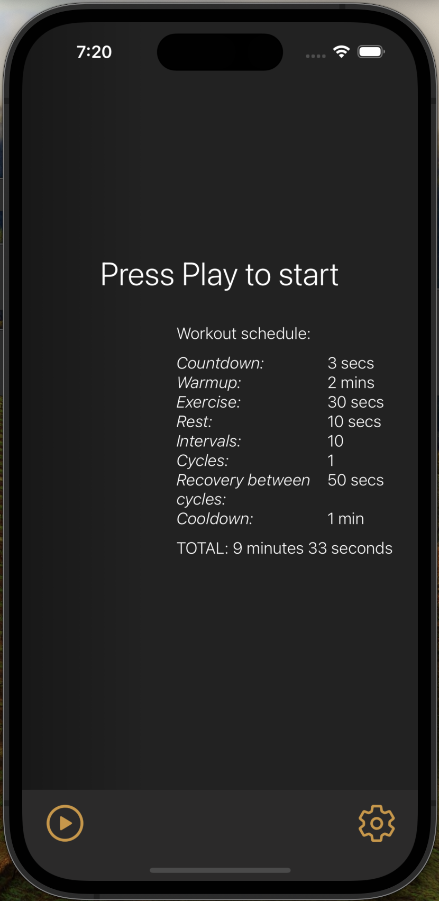
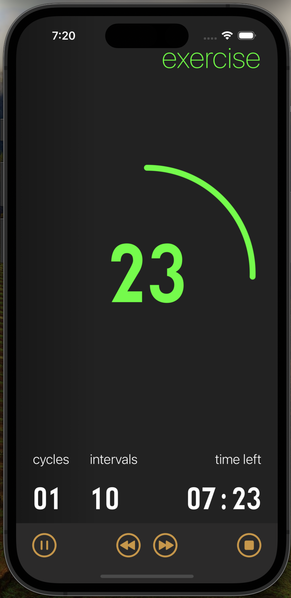
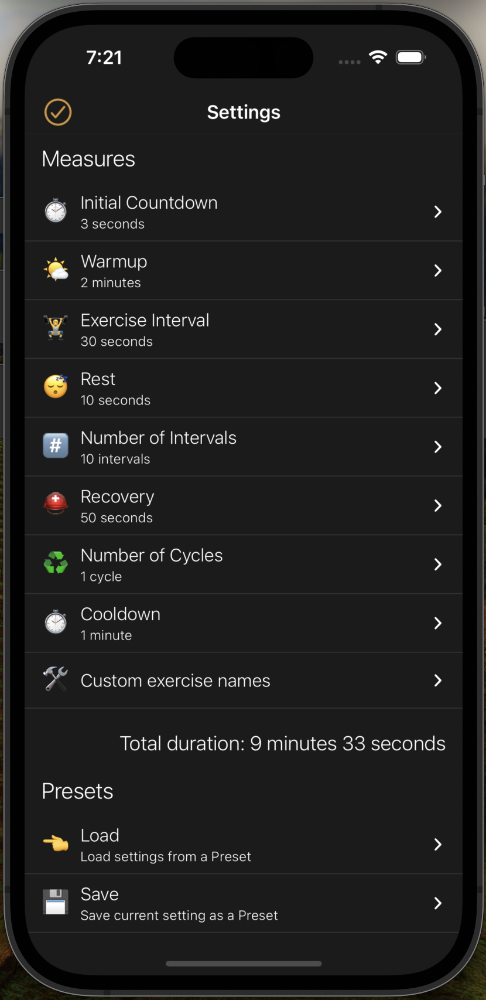

# Tabata Timer

A simple, configurable interval timer for [Tabata](https://en.wikipedia.org/wiki/High-intensity_interval_training#Tabata_regimen) and other HIIT workouts. It runs on iOS, Android and the web, and is written in React Native with [Expo](https://docs.expo.dev/).

<p align="center">
  
  
  
</p>

## Features

- **Configurable workout structure.** Every phase of a session has its own setting:
  - Initial countdown
  - Warmup
  - Exercise interval
  - Rest
  - Number of intervals (one interval = exercise + rest)
  - Recovery (the break between cycles)
  - Number of cycles
  - Cooldown
- **Live timer screen.** A circular progress indicator, color-coded by phase, shows the time left in the current phase, which interval and cycle you're on, and the total workout time.
- **Audio cues.** Sounds for the start, the final-second countdown beeps and phase changes. Playback keeps working while the app is in the background.
- **Screen stays awake** while the timer screen is open.
- **Presets.** Built-in *Tabata* (20s work / 10s rest) and *HIIT* (40s work / 20s rest) presets. You can save your own, rename or delete them, and restore the defaults.
- **Custom exercise names.** Give each interval a name (e.g. "Burpees", "Squats") so you know what's coming next.
- **Persistent settings.** Your settings and presets are saved on the device between sessions.
- Works in portrait and landscape, on phones and tablets.

## Tech stack

- [Expo](https://expo.dev/) / React Native, written in TypeScript
- [Redux Toolkit](https://redux-toolkit.js.org/) with [redux-persist](https://github.com/rt2zz/redux-persist) (AsyncStorage) for state
- [React Navigation](https://reactnavigation.org/) (stack navigator)
- `expo-audio`, `expo-keep-awake`, `react-native-svg`
- Jest (`jest-expo`) for tests

## Project structure

```
App.tsx            App entry: store provider, fonts, navigation
src/
  components/      Reusable UI (Timer, PercentageCircle, inputs, preset modals, …)
  screens/         Main timer, Settings, and preset Load/Edit screens
  routes/          Navigation stack and route types
  store/           Redux slices (timer, presets), selectors and types
  utils/           Time formatting, sounds, and hooks (useInterval, useOrientation, …)
  assets/          Fonts, images and sounds
test/              Unit tests for selectors and utilities
```

## Getting started

Prerequisites: Node.js and npm. To run on a device, install the Expo Go app or set up an iOS simulator or Android emulator.

```sh
npm install
npm start          # start the Expo dev server
npm run ios        # open in the iOS simulator
npm run android    # open on an Android emulator or device
npm run web        # open in the browser
```

### Other scripts

```sh
npm test           # run the Jest test suite
npm run lint       # type-check with tsc and lint with ESLint
```

## Building

Builds and over-the-air updates go through [EAS](https://docs.expo.dev/eas/). The build profiles (`development`, `preview`, `production`) are defined in [`eas.json`](eas.json).

```sh
eas build --profile production --platform ios
```
